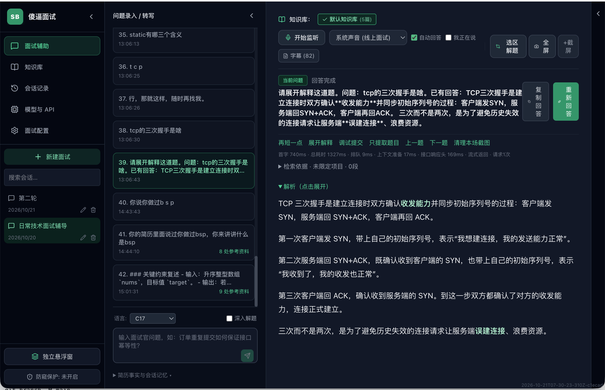

# 傻逼面试

一个使用自己 API 的 macOS 面试辅助工具：听问题、看字幕、查资料、生成回答，也能截图识题和解代码题。无需注册本软件账号；模型服务需要自行配置，调用费用由对应服务商收取。

[下载安装包](https://github.com/xiaobendaoke/ShaBiMianShi/releases) · [反馈问题](https://github.com/xiaobendaoke/ShaBiMianShi/issues)



> 图片是作者的使用示例。安装包不附带截图中的简历、项目资料、会话或 API 密钥。

## 能做什么

- **语音听题**：采集系统声音、麦克风或两者，自动分段转写，在停顿后生成回答。
- **资料问答**：导入简历、项目文档和笔记，结合选择的知识库回答项目问题。
- **截图解题**：选区或全屏截图，交给支持图片的模型识题、解题；支持追加多张截图。
- **调整回答**：再短一点、展开解释、重新回答；保留会话记录及问答上下文。
- **独立悬浮窗**：显示答案，支持快捷键显示/隐藏和鼠标穿透。

## 下载安装

当前发布的是 **macOS Apple Silicon（M 系列芯片）测试版**。最低系统目标为 macOS 13；尚未完成所有系统版本与会议软件的实机验证。Intel Mac、Windows 和 Linux 暂无已验证的安装包。

1. 打开 [Releases](https://github.com/xiaobendaoke/ShaBiMianShi/releases)，下载 `ShaBiMianShi-版本号-mac-arm64.dmg`。普通用户无需下载 Source code，也无需安装 Node.js。
2. 双击 DMG，把 **傻逼面试.app** 拖到 **Applications（应用程序）**。
3. 弹出磁盘映像，从“应用程序”打开“傻逼面试”。以后都从这里启动。

### 首次打开的系统提示

当前安装包使用临时签名，**尚无 Apple Developer ID 签名和 Apple 公证**。macOS 可能拦截首次打开。如果确认下载来源可信，按 [Apple 官方说明](https://support.apple.com/zh-cn/102445)，在“系统设置 → 隐私与安全性”中处理该应用的“仍要打开”提示；受设备管理策略限制的电脑可能无法放行。

- **钥匙串提示**：用于解密本机保存的 API 密钥。确认请求来自本软件后，可自行决定是否“始终允许”。更新构建后可能再次询问，不能保证完全免密码。
- **麦克风权限**：使用麦克风听题时需要。
- **屏幕录制／屏幕与系统音频录制权限**：截图和系统声音采集时需要；名称因 macOS 版本而异。授权后若系统要求，完整退出软件再打开。

正式签名、公证和首次权限授权是不同的事。本测试版不要求关闭系统整体安全保护。

## 第一次使用：先配置模型

打开左侧 **模型与 API**。从你使用的模型服务商获取 API Key、API 基础地址和模型名称，按服务商文档填写；不要把网页聊天地址当作 API 地址。

| 配置 | 用途 | 什么时候需要 |
|---|---|---|
| 默认问答模型 | 文字提问与生成回答 | 使用文字问答时 |
| 图片模型 | 看截图、识题与代码解题 | 使用截图功能时，必须支持图片输入 |
| ASR／语音转写 | 把声音变成文字 | 使用语音监听时 |
| 向量服务 | 文档向量化与语义检索 | 使用知识库语义召回时 |

每项通常需要填写 **Base URL、API Key、模型标识**，然后点击该项的 **保存**。

- 文字和图片默认共用问答模型。如果文字模型不支持图片，开启“图片使用独立模型”，再配置可读取图片的模型。
- 语音转写服务必须支持应用使用的音频转写接口，不能用普通聊天模型代替。
- 向量模型必须支持 embeddings。更换向量模型或服务地址后，按提示重新构建向量；问答模型不等于向量模型。
- “同步到全部”会把配置同步到其他服务项；只有服务商确实同时提供这些能力时才使用。

保存后按需点击 **测试服务 → 测试图片能力 → 测试真实音频**。这些测试会向你配置的服务发送测试请求，并可能产生费用。图片和音频使用随包附带的测试夹具。

**先跑通最简单的一题**：点击“新建面试”，在底部输入“解释一下 TCP 三次握手”，发送后能看到回答，再继续配置语音和知识库。

## 导入自己的简历和项目资料

1. 打开 **知识库**，新建知识库，或使用默认知识库。
2. 点击 **批量选择文件** 或 **导入文件夹**，导入 PDF、DOCX、Markdown、TXT 文档。
3. 等待文档状态变成 **已就绪**。扫描版 PDF 可能缺少可提取文字，不能保证直接解析。
4. 回到 **面试辅助**，在上方选择本次会话需要的知识库。
5. 在“简历事实与会话记忆”等区域补充已确认的项目事实和目标职位信息，再提问。

例如：“我在这个项目中负责什么？”“这个问题最后怎么定位的？”“结合资料帮我简短回答”。资料里应写清自己的职责、方案、结果和可核实数字。模型仍可能出错，项目经历和数字需要自行核对。

普通基础题可直接回答，项目题会检索资料；需要严格限制来源时，选择“仅依据资料”策略。可以使用知识库中的“检索测试”检查召回结果。

## 开始语音听题

1. 新建或选择一个会话。
2. 在音源下拉框选择：线上会议通常选 **系统声音**；面对面练习选 **麦克风**；需要同时采集时选两者。
3. 点击 **开始监听**，按系统提示授权。系统音源需要电脑确实在播放会议或测试声音。
4. 勾选 **自动回答**，说话停顿且转写完成后会自动提交；取消勾选后可手动提交。
5. 自己回答期间使用 **我在说／本人回答状态**，避免自己的话再次触发提问。字幕识别不准时，可编辑后发送。

这是**自动分段转写**，不是逐字实时字幕。回答生成期间仍可收下一题；可用“立即切换下一题”取消当前生成并推进队列。切换会话会停止旧会话收音，换设备后请停止再重新开始监听。

双音源默认只让系统音触发自动回答；软件不做声纹识别。转写失败时会暂停自动提交，重试后需要检查字幕并手动发送。

## 截图和代码题

1. 先确认模型通过 **测试图片能力**。
2. 点击 **选区解题**，框选题目；或使用 **全屏** 截取主显示器。截图过程中软件会隐藏自己的窗口，再恢复。
3. 多张题目使用 **追加截图**，检查预览后点击 **确认提交**；最多 8 张。
4. 在底部选择代码语言，默认 C17，也可选 C++、Java、Python、JS/TS、Go。题目明确要求语言时优先遵循题目。
5. 需要调整时用 **只提取题目**、**展开解释**，或追加错误截图后 **调试提交**。

“深入解题”依赖服务商及模型支持。截图会发送到所配置的模型服务；提交前检查画面是否含不想发送的内容。

## 看答案与悬浮窗

默认回答偏简短口语。觉得太长可点 **再短一点**，需要原理或步骤可点 **展开解释**，生成不合适可点 **重新回答**。

左下角 **独立悬浮窗** 可单独显示回答。内容保护在不同录屏与会议软件中的效果需要自行验证，不保证始终不可见。关闭主窗口会清理音源；需要继续监听时使用隐藏窗口功能。

| 操作 | 快捷键 |
|---|---|
| 显示／隐藏悬浮窗 | `Cmd+Shift+Space` |
| 鼠标穿透 | `Cmd+Shift+P` |
| 主屏截图解题 | `Cmd+Shift+S` |
| 选区解题 | `Cmd+Alt+X` |
| 开始／暂停／继续监听 | `Cmd+Shift+G` |
| 立即回答语音问题 | `Cmd+Shift+Enter` |
| 切换本人回答状态 | `Cmd+Shift+M` |
| 上一题／下一题 | `Cmd+Alt+←` / `Cmd+Alt+→` |
| 答案滚动 | `Cmd+↑` / `Cmd+↓` |

快捷键冲突时，主界面会提示，也可以使用按钮。

## 常见问题

| 问题 | 排查方法 |
|---|---|
| 文字问题也没有回答 | 检查配置是否保存、Base URL、模型名、密钥和余额，先运行“测试服务” |
| 文字可以，截图不行 | 使用支持图片输入的模型，并运行“测试图片能力” |
| 听不到系统声音 | 确认正在播放声音、音源选择正确，检查屏幕／系统音频权限，完整重启软件再试 |
| 麦克风没有字幕 | 检查麦克风权限、输入设备和音量，再运行“测试真实音频” |
| 回答自己的话也被识别成问题 | 开启本人回答状态，或使用系统声音作为触发音源 |
| 项目回答不符合资料 | 检查选中的知识库、文档状态和检索结果；补充事实，必要时使用“仅依据资料” |
| 更换模型后资料召回异常 | 检查向量服务，重新构建该配置对应的文档向量 |
| 更新后看不到旧资料 | 不要立即重建或删除数据库；检查是否使用同一 macOS 账号，保留数据目录后提交问题 |

反馈时请提供软件版本、macOS 版本、芯片类型、复现步骤和脱敏后的报错；不要上传 API Key、完整私人简历或本地数据库。

## 数据和隐私

资料、会话、字幕和历史截图保存在本机。密钥通过本机加密机制保存；默认数据目录保留兼容路径 `~/Library/Application Support/面试狗-独立版/`，名称不会影响界面显示。更新应用前建议备份数据目录，不要通过删除该目录来更新软件。

**本地保存不等于离线处理**：提问、检索上下文、截图、语音片段及文档向量化所需内容，会根据启用的功能发送到你配置的 API 服务商。原始语音片段仅在内存中短暂保留，字幕写入本地会话。

开发仓库中的 `personal/` 用来放个人资料和备份，已被 Git 忽略。普通安装用户无需创建它，安装包不包含作者的 `personal/`。请遵守所在场景的录音、信息处理与工具使用规则。

## 从源码运行与构建

需要 macOS、与项目依赖兼容的 Node.js/npm；打包系统音频助手还需要 Xcode Command Line Tools（`swiftc`）。本机发布流程目前验证 Apple Silicon。

```sh
git clone https://github.com/xiaobendaoke/ShaBiMianShi.git
cd ShaBiMianShi
npm ci
npm run dev
```

构建和测试：

```sh
npm run build
npm run test:repair
node --import tsx test/projectRetrieval.test.ts
npm run test:all
```

本机应用和分发包：

```sh
npm run pack
npm run dmg
```

`pack` 前完整退出已运行的打包应用。应用输出位于 `release/mac-arm64/傻逼面试.app`，DMG 位于 `release/`。源码启动器 `启动傻逼面试.command` 打开最近一次本地构建；通过 DMG 安装的用户直接从“应用程序”启动。

DMG 脚本只打包构建出的 `.app`，不会复制工作目录的个人资料；当前仍为临时签名、未公证构建。真实服务测试需显式运行，会使用已配置服务并产生 API 用量。

| 目录 | 内容 |
|---|---|
| `src/` | Electron 主进程、预加载、React 界面与共享逻辑 |
| `native/` | 系统音频采集助手源码 |
| `resources/probes/` | 图片和语音能力测试夹具 |
| `scripts/` | 应用打包与 DMG 制作脚本 |
| `test/` | 回归测试和合成夹具 |
| `docs/` | 文档、界面截图、依赖许可说明 |
| `personal/` | 本地个人资料与备份，不提交、不打包 |

## 许可证

源码按 [MIT License](LICENSE) 发布，依赖许可见 [说明](docs/DEPENDENCIES.md)。
