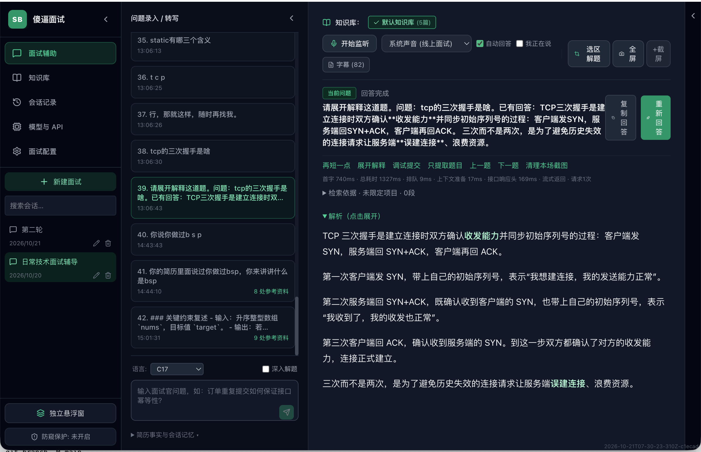
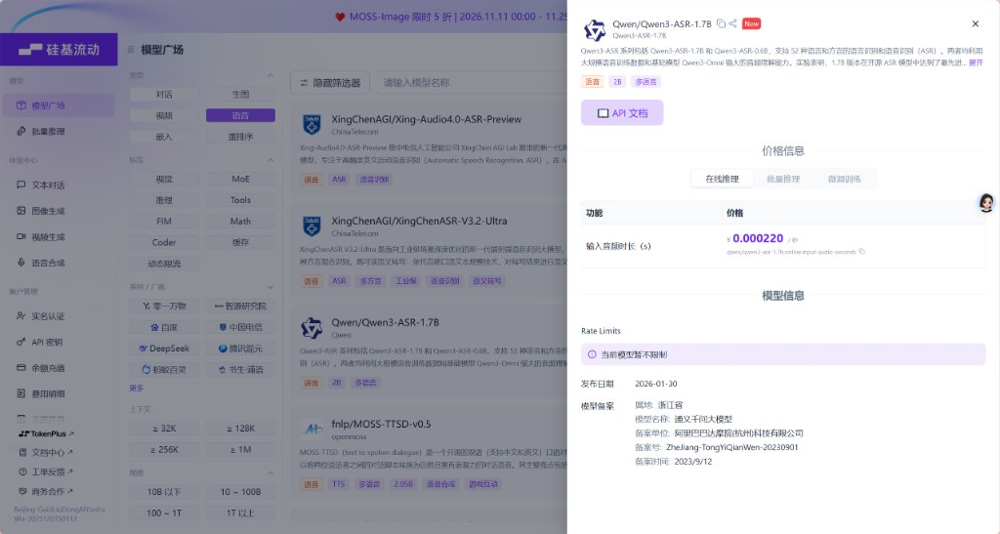
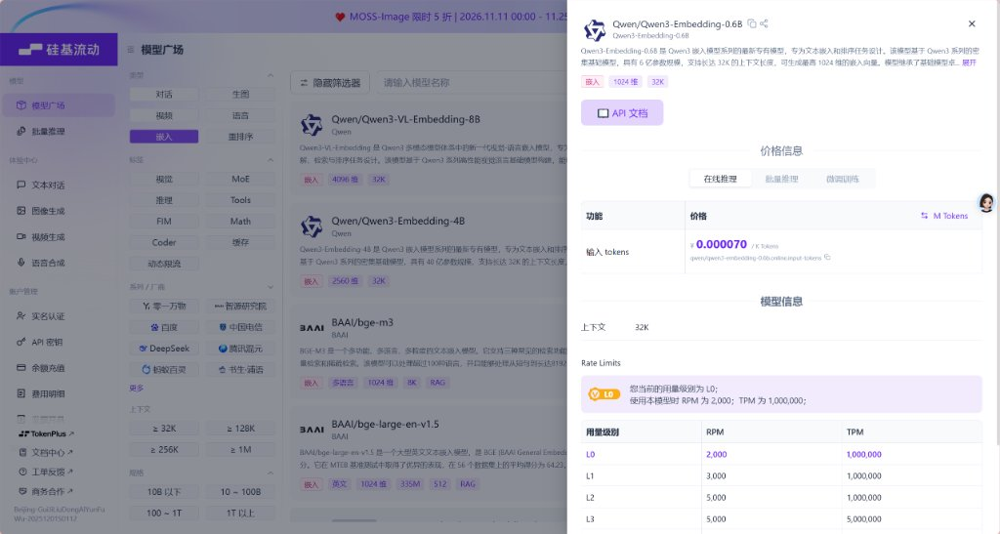
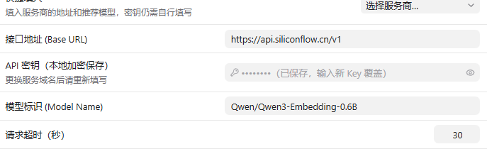

# 傻逼面试

> 面试官一开口，答案就在这里。

一个跨平台（**macOS & Windows**）面试辅助桌面应用：听问题、出字幕、查你自己的资料、生成口语化回答，也能截图识题、解代码题。

- **免登录**：没有本软件账号体系，也不连任何“官方”后端。
- **自带 API**：问答、看图、语音转写、向量检索都走你自己配置的模型服务（OpenAI 兼容接口），费用由服务商收取。
- **数据在本机**：资料、会话、字幕存在本地 SQLite；API Key 用系统安全存储（macOS 钥匙串 / Windows DPAPI）加密保存。

[下载安装包](https://github.com/xiaobendaoke/ShaBiMianShi/releases) · [反馈问题](https://github.com/xiaobendaoke/ShaBiMianShi/issues)



---

## 功能

| 功能 | 说明 | macOS 快捷键 | Windows 快捷键 |
|---|---|---|---|
| 🎙️ 语音听题 | 采集系统声音、麦克风或两者，自动分段转写，停顿后自动提交回答 | `⇧⌘G` | `Ctrl+Shift+G` |
| ✂️ 选区解题 | 框选题目截图交给图片模型，支持多显示器与高分屏、多张追加（最多 8 张），可选 C17 / C++ / Java / Python / JS / TS / Go | `⌥⌘X` | `Ctrl+Alt+X` |
| 📚 资料问答 | 导入简历、项目文档、笔记，关键词 + 向量混合检索，回答带出处 | — | — |
| 🪟 悬浮窗 | 独立置顶窗口显示答案，支持鼠标穿透、透明度、防窥内容保护 | `⇧⌘Space` | `Ctrl+Shift+Space` |
| 🔁 调整回答 | 再短一点 / 展开解释 / 重新回答；保留会话上下文与记忆 | — | — |

默认回答是**口语短答**：普通基础题直接回答，涉及个人经历的题目会检索资料；需要严格限制来源时选“仅依据资料”策略。

## 安装

同时支持 **macOS（Apple Silicon M 系列 / Intel，macOS 13+）** 与 **Windows 10 / 11（64 位免安装便携版）**。

### Windows
1. 从 [Releases](https://github.com/xiaobendaoke/ShaBiMianShi/releases) 下载 `ShaBiMianShi-<版本>-win-x64-portable.zip`。
2. **完整解压**到任意目录（不要在压缩包内直接双击运行）。
3. 双击解压目录内的 **傻逼面试.exe** 启动。
   - 当前版本未购买商业 EV 代码签名证书，首次运行如遇 Windows SmartScreen 提示“Windows 已保护你的电脑”，点击 **更多信息 → 仍要运行**。
   - 采集系统声音直接走 Windows 原生 **WASAPI Loopback**（无需安装虚拟声卡，也无需屏幕录制权限）；使用麦克风时请允许麦克风访问权限。

### macOS
1. 从 [Releases](https://github.com/xiaobendaoke/ShaBiMianShi/releases) 下载对应芯片的 `ShaBiMianShi-<版本>-mac-arm64.dmg`（M 系列）或 `ShaBiMianShi-<版本>-mac-x64.dmg`（Intel）。
2. 把 **傻逼面试.app** 拖进“应用程序”，从“应用程序”打开。
3. 安装包采用临时签名，**未经 Apple 公证**，首次打开如被拦截，请前往“系统设置 → 隐私与安全性”点击“仍要打开”（[Apple 说明](https://support.apple.com/zh-cn/102445)），并按需授权钥匙串、麦克风、屏幕与系统音频录制权限。

## 五分钟上手

### 1. 配置模型

打开软件左侧 **模型与 API**，分别配置问答、语音转写（ASR）和向量嵌入（Embedding）三项服务，填好后点击 **保存**。

| 配置项 | 用途 | 推荐模型 / 要求 |
|---|---|---|
| 默认问答模型（文字 / 图片 / 代码） | 文字问答、截图识题、代码题 | 建议配置支持图片输入的多模态流式模型（如 OpenAI / Gemini / 通义千问 / DeepSeek 等兼容接口） |
| 语音转写（ASR） | 声音转文字 | 推荐使用硅基流动 `Qwen/Qwen3-ASR-1.7B`（必须支持 `/audio/transcriptions` 接口，普通聊天模型不可用） |
| 向量服务（Embedding） | 知识库语义检索 | 推荐使用硅基流动 `Qwen/Qwen3-Embedding-0.6B`（必须支持 `/embeddings`；换模型后需点“重建全库向量”） |

#### 推荐方案：使用硅基流动配置 ASR 与 Embedding（图文教程）

语音转写（ASR）和向量嵌入（Embedding）推荐使用 [硅基流动 SiliconFlow](https://cloud.siliconflow.cn/)——国内直连延迟低、单价便宜，且**同一个 Base URL 和 API Key 可同时用于这两项服务**：

1. **获取 API 密钥**：访问 https://cloud.siliconflow.cn/ 注册并登录，在左侧栏点击 **账户管理 → API 密钥**，新建并复制一条 `sk-` 开头的密钥。
2. **查看推荐模型标识**：在硅基流动 **模型广场** 中，语音识别推荐选择 `Qwen/Qwen3-ASR-1.7B`，文本向量嵌入推荐选择 `Qwen/Qwen3-Embedding-0.6B`（可点击模型名右侧复制图标直接复制完整标识）：

   - **语音转写推荐模型：`Qwen/Qwen3-ASR-1.7B`**（模型广场 → 语言/语音分类）
     

   - **向量嵌入推荐模型：`Qwen/Qwen3-Embedding-0.6B`**（模型广场 → 嵌入分类，1024 维 / 32K 上下文）
     

3. **在软件「模型与 API」中填写参数**：直接复制下表参数填入对应输入框，点击右下角 **保存**（或顶部 **全部保存**）：

   | 软件内卡片 | 接口地址 (Base URL) | API 密钥 | 模型标识 (Model Name) | 请求超时（秒） |
   |---|---|---|---|---|
   | **语音转写模型 (ASR)** | `https://api.siliconflow.cn/v1` | 填入硅基流动 `sk-...` 密钥 | `Qwen/Qwen3-ASR-1.7B` | `30` |
   | **向量嵌入模型 (Embedding)** | `https://api.siliconflow.cn/v1` | 填入同一个硅基流动 `sk-...` 密钥 | `Qwen/Qwen3-Embedding-0.6B` | `30` |

   填写效果如下图所示（注意接口地址末尾保留 `/v1`，模型标识严格区分大小写并带上 `Qwen/` 前缀）：

   

4. **连通性自检**：保存后依次点击卡片下方的 **测试服务 → 测试图片能力 → 测试真实音频**（使用随包附带的 `resources/probes/` 夹具，会产生极少量 API 调用费）。若此前已用其他向量模型导入过文档，切换为 `Qwen/Qwen3-Embedding-0.6B` 保存后请点一次 **重建全库向量**。

先跑通最简单的一题：**新建面试**，输入“解释一下 TCP 三次握手”，能看到回答就说明问答链路正常。

### 2. 导入自己的资料

1. **知识库** → 新建或使用默认知识库。
2. **批量选择文件** 或 **导入文件夹**，支持 PDF / DOCX / Markdown / TXT。扫描版 PDF 没有文字层，会被标记为需要 OCR。
3. 等状态变成 **已就绪**，可以用“检索测试”看召回结果。
4. 回到 **面试辅助**，在右上角选择本次要用的知识库。

资料里写清楚**自己的职责、方案、结果和可核实的数字**，回答质量会好很多。模型仍可能出错，数字请自己核对。

### 3. 开始听题

1. 音源选择：线上面试选 **系统声音**，面对面练习选 **麦克风**，也可以两者都选（双音源模式下只有系统声音会触发自动回答）。
2. 点 **开始监听**，勾选 **自动回答**。
3. 自己作答时打开 **我正在说**（macOS `⇧⌘M` / Windows `Ctrl+Shift+M`），避免自己的话被当成问题。

这是**自动分段转写**，不是逐字实时字幕。生成回答时仍会继续收下一题，可用快捷键立即切到下一题。

## 快捷键

| 操作 | macOS | Windows |
|---|---|---|
| 显示 / 隐藏悬浮窗 | `⇧⌘Space` | `Ctrl+Shift+Space` |
| 鼠标穿透 | `⇧⌘P` | `Ctrl+Shift+P` |
| 全屏截图解题 | `⇧⌘S` | `Ctrl+Shift+S` |
| 选区解题 | `⌥⌘X` | `Ctrl+Alt+X` |
| 开始 / 暂停 / 继续监听 | `⇧⌘G` | `Ctrl+Shift+G` |
| 立即回答当前语音问题 | `⇧⌘↩` | `Ctrl+Shift+Enter` |
| 切换“我正在说” | `⇧⌘M` | `Ctrl+Shift+M` |
| 上一题 / 下一题 | `⌥⌘←` / `⌥⌘→` | `Ctrl+Alt+←` / `Ctrl+Alt+→` |
| 答案滚动 | `⌘↑` / `⌘↓` | `Ctrl+↑` / `Ctrl+↓` |

快捷键被其他软件占用时，主界面会提示，按钮同样可用。

## 工作原理

```
系统声音 / 麦克风 ──► 分段 ──► ASR 转写 ──► 字幕（可编辑）
                                            │
截图 ──► 图片模型提取题目 ───────────────────┤
                                            ▼
                              问题 ──► 混合检索（关键词 + 向量）
                                            │  知识库 / 简历事实 / 会话记忆
                                            ▼
                                      问答模型流式生成
                                            │
                                 主窗口 ◄───┴───► 悬浮窗
```

- **系统声音**：
  - **macOS**：`native/SystemAudio.swift`（ScreenCaptureKit）编译出的原生助手采集。
  - **Windows**：`native/SystemAudio.cs`（WASAPI Loopback，使用系统内置 `.NET Framework csc.exe` 编译）采集，带静音保活与默认播放设备热切换重连，缺失时自动回退 WebAudio Loopback。
  - 主进程 `audioSession` 统一管理 16kHz VAD 分段、半句追问合并与转写重试。
- **文档入库**：解析（`parsers/`）→ 按章节切块（`chunker/`）→ 写入 SQLite → 建关键词索引和向量索引（`indexing/`），由 `ingestionQueue` 排队处理。
- **模型调用**：`providerService` 统一封装对话流、图片识题、语音转写、embeddings 和服务测试，全部指向你配置的端点。

## 从源码运行

需要 **Node.js 22+**。
- **macOS**：打包系统音频助手需要 Xcode Command Line Tools（`swiftc`）。
- **Windows 10 / 11**：无需安装 Visual Studio C++ 工具链（`better-sqlite3` 使用内置 N-API 预编译包，WASAPI 音频助手使用 Windows 系统自带 `csc.exe` 自动编译）。

```sh
git clone https://github.com/xiaobendaoke/ShaBiMianShi.git
cd ShaBiMianShi
npm ci
npm run dev          # 开发模式（自动生成图标与原生系统音频组件）
```

```sh
npm run build        # 图标/音频组件准备 + 类型检查 + 构建
npm test             # 核心测试
npm run test:all     # 全部回归与双端发布器测试
npm run test:repair  # 修复安全 + 面试流程 + 生产回归
npm run bench        # 规模基准
```

```sh
# 跨平台本地打包与归档（请先完整退出正在运行的应用）
npm run pack         # macOS 生成 release/mac-<arch>/傻逼面试.app；Windows 生成 release/win-unpacked/傻逼面试.exe
npm run release:pkg  # macOS 生成 DMG；Windows 生成免安装 Portable ZIP 与 SHA256
```

- macOS 双击 `启动傻逼面试.command`、Windows 双击 `启动傻逼面试.bat` 可直接拉起最近一次 `pack` 出来的应用，并在源码有更新时给出提示。

### 技术栈

Electron · React 19 · TypeScript · Vite · Tailwind CSS 4 · better-sqlite3 · pdf-parse · mammoth · lucide-react

界面固定为白色浅色主题，配色变量集中在 `src/renderer/src/index.css` 的 `:root`。

### 目录结构

```
src/
├── main/                  Electron 主进程
│   ├── index.ts           启动、IPC、快捷键
│   ├── windows/           主窗口与悬浮窗管理（macOS hiddenInset / Windows titleBarOverlay）
│   ├── services/          模型调用、音频会话、截屏、入库队列、面试流程
│   ├── indexing/          关键词索引、向量索引、混合检索
│   ├── parsers/           PDF / DOCX / Markdown / TXT 解析
│   ├── chunker/           文档切块
│   ├── db/                SQLite 存储
│   └── resources/         预置面试题库
├── preload/               渲染进程可用的安全 API
├── renderer/              React 界面
└── shared/                主进程与界面共享的类型和逻辑
native/                    原生系统音频采集助手（macOS Swift / Windows C# WASAPI）
resources/probes/          图片 / 语音能力测试夹具
scripts/                   图标生成、原生编译、双端打包、DMG / ZIP 与启动脚本
test/                      回归测试、端到端冒烟与合成夹具
docs/                      截图、依赖许可
```

## 常见问题

| 问题 | 排查 |
|---|---|
| 文字问题没有回答 | 检查是否保存、Base URL、模型名、密钥和余额，先跑“测试服务” |
| 文字可以，截图不行 | 换支持图片输入的模型，跑“测试图片能力” |
| 听不到系统声音 | 确认电脑有连接扬声器/耳机输出设备并正在播放声音；macOS 需开启系统音频录制权限并重启 |
| 麦克风没有字幕 | 检查系统麦克风隐私权限、输入设备和音量，跑“测试真实音频” |
| 自己说的话被当成问题 | 打开“我正在说”，或只用系统声音触发 |
| 项目回答和资料对不上 | 检查选中的知识库、文档状态和检索结果；必要时用“仅依据资料” |
| 换模型后检索异常 | 重建对应配置的文档向量 |
| 跨系统迁移数据后提示无法解密密钥 | Keychain 与 Windows DPAPI 密文不互通，点击顶部红色提示条“备份并重置密钥库”，重填一次 API Key 即可保留全部知识库与记录 |

## 数据与隐私

- **macOS 数据目录**：`~/Library/Application Support/面试狗-独立版/`
- **Windows 数据目录**：`%APPDATA%\面试狗-独立版\`
- 更新前建议备份，不要靠删除数据目录来“重装”。
- **本地保存 ≠ 离线处理**：问题、检索到的上下文、截图、语音片段和待向量化的文档内容，会按你启用的功能发给你配置的服务商。原始音频只在内存中短暂停留，转写后的字幕写入本地会话。
- 悬浮窗的防窥保护（macOS `NSWindowSharingNone` / Windows `WDA_EXCLUDEFROMCAPTURE`）在不同系统版本与会议软件里效果不同，请自行验证，不保证一定不可见。

请遵守所在场景的录音、信息处理和工具使用规定。用于面试练习、模拟面试没问题；在真实面试中使用前，先确认对方是否允许。

## 许可证

[MIT](LICENSE)。依赖许可见 [docs/DEPENDENCIES.md](docs/DEPENDENCIES.md)。
